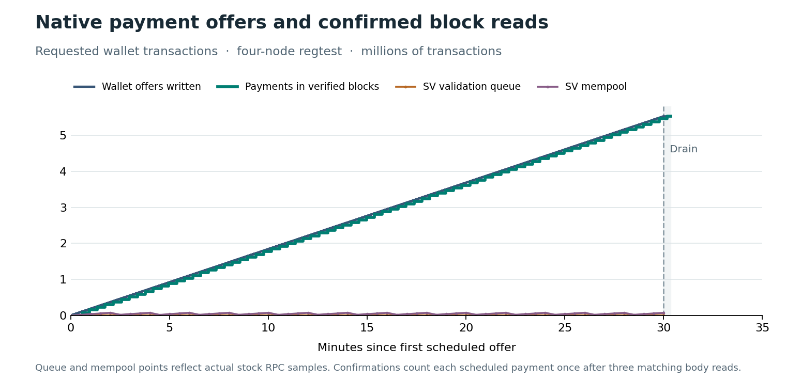

# Cold funding under continuous native wallet traffic

Four regtest nodes settled **5,529,600 distinct signed payments in 1,821.309198 seconds**, or **3,036.06 payments/s**, through two selected successors. Stock SV Node mined all 77 selected blocks. **Scary Node originated zero payments.** Its receiver was ready throughout all 225 primary work opportunities. Each recorded the same reason for withholding work, `no eligible pending transactions`. Successor-triggered admission on this release did not meet the registered requirement to originate a paying block in every five-minute window. [Original timed receipt](evidence/chronicle-sustained-cold.json.gz) · [Prospective registration](cold-miner-registration.md)



The entrant joined empty at height 449. It observed the funding split at height 484. When the first wallet announced a payment, that funding block had zero successors. Four wallets offered six groups of 512 signed transactions per second for 30 minutes in the original, generation-by-generation order. All 10,800 advertisements were written and the wallets recorded serving every payment. Two stock Teranodes and stock SV Node each returned the complete bytes of every selected block, totaling 1,103,139,534 bytes per reader. The entrant recorded 5,529,600 ordinary script checks. The audited blocks contained zero foreign and zero duplicate payments. The run closed without a resource stop or an audit failure. [Cold-start parameters](cold-miner-registration.md) · [Final four-node handoff](evidence/chronicle-sustained-cold-handoff.json) · [Measured hardware and Docker resources](evidence/chronicle-sustained-cold-platform.json)

## What happened to the waiting payments

Across 1,478 successful entrant samples, the SV P2P counter for offers retained pending a successor rose by 4,828,129 and the Teranode subtree counter rose by 85,023. Neither route recorded an admission or a promotion. The first operator read, 1.063 seconds after the start, already included 2,048 retained SV offers. By the last read the cumulative SV retention and discard counters both stood at 4,830,177. Both Teranode counters stood at 85,023. These count route events, including repeat arrivals. The release combines several discard reasons. It does not record a reason for each payment. [Sampled counter changes and endpoint heights](evidence/chronicle-sustained-cold-admission.json) · [Original recheck implementation](https://github.com/p2ppsr/scary-node/blob/c2a36d5c6a83f2262dffd596f5eecb421db6b132/src/mining/waiting.rs)

| Primary slots | Entrant unready / allocated | Stock solutions | Selected paying entrant blocks |
|---|---:|---:|---:|
| 0–49 | 38 / 38 | 12 | 0 |
| 50–99 | 37 / 37 | 13 | 0 |
| 100–149 | 38 / 38 | 12 | 0 |
| 150–199 | 37 / 37 | 13 | 0 |
| 200–249 | 38 / 38 | 12 | 0 |
| 250–299 | 37 / 37 | 13 | 0 |

## Final payment and settlement

The final advertisement finished at 1,799.880 seconds. The first complete wallet sample after serving all 5,529,600 distinct IDs was at 1,800.085 seconds. The last paying block at height 559 contained 71,680 payments. The first tip samples naming it arrived at 1,802.344 seconds on SV Node, 1,803.356 and 1,803.358 on the Teranodes, and 1,807.006 on Scary Node. The three complete stock body reads finished at 1,809.155, 1,807.712 and 1,807.676 seconds respectively. Verification and accounting of the group completed at 1,809.825 seconds. The final two blocks contained no scheduled payments. Their group audits finished at 1,815.569 and 1,821.163 seconds. The full denominator ends at 1,821.309 seconds. The wallets recorded zero drain readvertisements. [Worker, stock body, tip and settlement timings](evidence/chronicle-sustained-cold-settlement.json)

The original-order inventory control on the earlier release also recorded zero entrant blocks. On that earlier release, changing the timing of the same signed payments produced 30 selected entrant blocks. The measurements answer different questions. This cold-start result measures throughput for the four-node system under one exact schedule. The 225 entrant outcomes show why that rate cannot establish the entrant’s own block-production capacity here. [Original-order inventory control](sustained-native-replication.md) · [Reordered workload on the earlier release](witnessed-workload-results.md)

## Reproduce the measurement

Use the registration to stand up fresh stores, replay the original history and fund the same signed payment sequences. To check the published timing, opportunities, prepared work, receiver counters and handoff offline from the repository root, run the following commands. The registration includes the separate full signed-wire membership and parent-age commands. [Live run and full-wire verification](cold-miner-registration.md#reproduction)

```sh
receipt=docs/evidence/chronicle-sustained-cold.json.gz
.native/py/bin/python qualification/verify_sustained_native.py "$receipt"
.native/py/bin/python qualification/workload_windows.py "$receipt"
.native/py/bin/python qualification/workload_worker_headers.py "$receipt"
.native/py/bin/python qualification/workload_waiting_offers.py "$receipt"
.native/py/bin/python qualification/workload_settlement.py "$receipt"
.native/py/bin/python qualification/quiesce_sustained.py "$receipt" \
  --handoff docs/evidence/chronicle-sustained-cold-handoff.json
```
