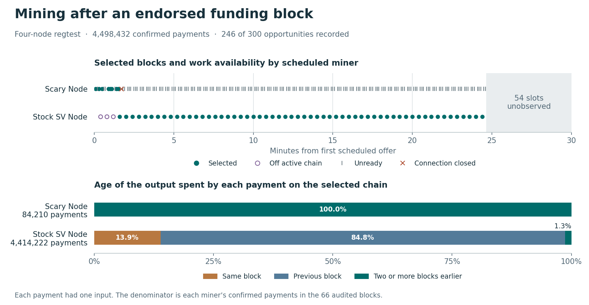

# An endorsed funding block at the start of native wallet traffic

A stock miner extended the height-484 funding block before the first payment arrived. The empty-state entrant had already witnessed those outputs and their first successor. The four wallets then announced signed payments from the registered finite source in the original order. The offer period called for 1,800 seconds, 10,800 batches of 512 payments, 225 Scary work opportunities and 75 stock SV Node opportunities. This is the only timed enrollment of the endorsed arm. [Preregistered design](witnessed-miner-registration.md)

The offer clock started on November 22, 2026, at 00:59:24.093 UTC. The final recorded work opportunity finished at 01:24:00.109 and the last inventory advertisement completed at 01:24:04.594, 1,480.501 seconds into the run. The exact process exit time and cause are unknown. The lowest recorded host and Docker free-space readings were 25.83 GiB and 47.01 GiB, above their 20 GiB and 12 GiB stop floors. The resource sampler recorded no stop. The eight Docker services stayed alive. The source and opportunity logs ended independently. Of 300 scheduled opportunities, 246 have recorded outcomes. The remaining 54 have no observed outcome. Independent post-interruption queries began at 01:29:48.852 UTC and found all four nodes still at the last audited parent, height 551. All eight original services were confirmed paused at 01:29:51.686. The experiment lacks its final offer, drain and settlement observations, so it supplies no estimate of full-period throughput. [Measured prefix, original log digests and subsequent queue readings](evidence/chronicle-sustained-endorsed-interruption.json.gz)

| Observed event | Count |
|---|---:|
| Native inventory batches announced | 8,884 |
| Payments advertised | 4,548,608 |
| Unique payments delivered at the final wallet counter sample | 4,546,560 |
| Independently read blocks / full stock body reads | 66 / 198 |
| Confirmed payments / witnessed input script checks | 4,498,432 / 4,498,432 |
| Selected Scary blocks / payments | 8 / 84,210 |
| Selected stock blocks / payments | 58 / 4,414,222 |
| Solves returned by stock outside the final audited chain | 3 |

Scary received 185 recorded opportunities. It solved eight, lacked an issuable job on 176 and observed one Stratum connection close. All 176 unready observations reported a connected receiver with contiguous coverage and working storage. On 172 slots there was no eligible pending transaction. On four it was waiting for independent observation after a solve on the selected parent.

| 50-opportunity window | Completed opportunities | Selected transaction-bearing Scary blocks |
|---:|---:|---:|
| 1 | 50 | 8 |
| 2 | 50 | 0 |
| 3 | 50 | 0 |
| 4 | 50 | 0 |
| 5 | 46 | 0 observed |
| 6 | 0 | Unobserved |

The initial endorsement let Scary start mining immediately. Three subsequent **fully observed** windows contained no Scary block, which rules out the registered requirement for one nonempty Scary block in each window. The last observed reference tip was `6bdadaef13a3c69736333fd69a6854454a6fd5cb8cbd11e22b880c94e7d87115`. All 66 audited Merkle commitments and 897,424,918 body bytes are bound to independent readbacks from SV Node and both Teranodes.

The signed-input replay checked all 5,529,600 source envelopes and reconstructed every observed previous outpoint. Scary’s 84,210 selected payments all used outputs created two to nine blocks before inclusion. In stock-mined blocks, 613,134 payments used a same-block parent, 3,743,743 spent an output from the immediately preceding block, and 57,345 spent an older output. After the first empty Scary pool sample at height 494, the next 57 selected blocks carried 4,218,307 payments. Of these, 482,755 spent a same-block output and 3,735,552 spent an output from the immediately preceding block. No payment in those 57 blocks had the confirmed successor on its input’s creating block that Scary required at template time. Every fee was 200 satoshis. The eight Scary coinbases collected 16,842,000 satoshis above subsidy. Stock collected 882,844,400. The complement of the confirmed membership within the advertised prefix matched the stock mempool exactly by transaction ID. [Input ages, amounts and full-wire results](evidence/chronicle-sustained-endorsed-membership.json)

Scary last reported a nonempty pool at height 493, with 19,168 pending payments 102.799 seconds into the run. It next reported zero at height 494, at 109.268 seconds. All 1,149 status replies from that point through 1,480.171 seconds had zero pending payments, three connected peers, healthy storage and receiver readiness. Since the last nonempty reply, the SV transport had counted 4,280,792 ineligible arrivals and the Teranode subtree transport 9,327,847. Neither transport recorded a new admission. An arrival counter can count a payment more than once. It measures intake activity and cannot identify an individual reason for ineligibility. [Original status and transport counters](evidence/chronicle-sustained-endorsed-interruption.json.gz)

After the interruption, SV Node reported 50,176 pending transactions. Two further complete stock membership queries yielded the same ordered-ID commitment. On each reading, both Teranodes reported a candidate for height 552 containing 49,151 transactions. Scary had zero eligible transactions. Every one of those 50,176 pending payments spent an output created in the selected height-551 tip. Each was therefore still waiting for its parent block’s first successor under the entrant’s template rule. Those later measurements describe pending work at the saved parent. The missing primary endpoints remain unknown.

SV Node and both Teranodes served identical complete sibling blocks from stock slots 3, 7 and 11. Together the three siblings contained 63,671,832 bytes. Their heights were 486, 487 and 491. Each stock RPC lookup reported −1 confirmations and identified a different selected block at that height. The 225 entrant and 75 stock scheduled opportunities measure mining under wallet load. Estimating a stale-rate difference at equal hashpower and matched propagation requires the separate tip-race experiment. [Matched receiver study](propagation-control.md)

Each Teranode also served its own unpublished height-552 template. Both committed to the same 49,151 ordinary payments, all present in the original SV Node mempool. Only 20 payments occupied the same position in both templates. Each template was 9,805,475 bytes. These queue and template queries ran after the timed observations ended. [Sibling and template replay results](evidence/chronicle-sustained-endorsed-terminal-wires.json)

A fresh SV Node v1.2.3 and Teranode v0.16.1 with new data stores started at regtest genesis and selected the original height-551 hash. The Teranode returned all 66 complete selected bodies, reproducing all 897,424,918 bytes. The fresh SV Node began with an empty mempool. Reoffering the 50,176 pending signed payments reproduced the original stock mempool membership exactly. The original services remained paused throughout this independent recovery. [Fresh-node block and mempool recovery](evidence/chronicle-sustained-endorsed-fresh-teranode.json)

## Replay

The interruption verifier checks every complete original JSONL record against its source digest. It also checks the offer and opportunity schedules, header proof of work and linkage, three readback commitments per block, and the chronology of the later queue observations. The full wire comparison also decodes every selected transaction against the shared signed wallet corpus, checks Merkle roots, computes fees and parent ages from the actual inputs and outputs, and compares the remainder of the advertised set with the independent stock mempool commitment. Use Python 3.12 or later and the GitHub CLI from the repository root. The commands below check the signed source archive and funding history, then unpack the archived active bodies into a new directory. The compressed stock mempool file preserves all 50,176 IDs in internal byte order. The final command rebuilds the three sibling blocks and both unpublished candidate bodies, checks their headers and commitments, and compares the candidates with that mempool. [Endorsed active bodies and pending IDs](https://github.com/p2ppsr/scary-node/releases/tag/native-workload-endorsed-prefix-v1) · [Common signed source](https://github.com/p2ppsr/scary-node/releases/tag/native-workload-regtest-v1)

~~~sh
python3 -m venv .native/py
.native/py/bin/pip install ecdsa==0.19.1 msgpack==1.1.2
gh release download native-workload-regtest-v1 --repo p2ppsr/scary-node --dir offer-assets \
  --pattern paired-corpus.tar.gz --pattern sustained-signed.tar.gz
.native/py/bin/python qualification/sustained_dataset.py unpack offer-assets workload \
  --receipt docs/evidence/chronicle-sustained-source-assets.json
gh release download native-workload-endorsed-prefix-v1 --repo p2ppsr/scary-node --dir endorsed-assets
SIGNED_PAYMENTS=workload/sustained-signed
ENDORSED_BLOCKS=endorsed-assets/blocks
receipt=docs/evidence/chronicle-sustained-endorsed-interruption.json.gz
.native/py/bin/python qualification/interrupted_workload.py verify "$receipt"
.native/py/bin/python qualification/sustained_block_archive.py unpack "$receipt" "$SIGNED_PAYMENTS" endorsed-assets/active-bodies.zip "$ENDORSED_BLOCKS"
.native/py/bin/python qualification/interrupted_workload.py verify "$receipt" --corpus "$SIGNED_PAYMENTS" --blocks "$ENDORSED_BLOCKS"
.native/py/bin/python qualification/terminal_workload_wires.py verify "$receipt" "$SIGNED_PAYMENTS" endorsed-assets/stock-pending.sorted-internal.bin.gz endorsed-assets/terminal-wires.zip
~~~

To repeat the fresh-node recovery, use Docker with the pinned stock images and the unpacked funding history above. The driver uses a new regtest network and new stores. The offline check compares the result to the original observation and mempool commitment.

~~~sh
.native/py/bin/python qualification/recover_teranode_chain.py sustained "$receipt" fresh-endorsed.json \
  --history workload/paired-corpus --corpus "$SIGNED_PAYMENTS" \
  --archive endorsed-assets/active-bodies.zip --pending-ids endorsed-assets/stock-pending.sorted-internal.bin.gz
.native/py/bin/python qualification/recover_teranode_chain.py verify "$receipt" fresh-endorsed.json
~~~
