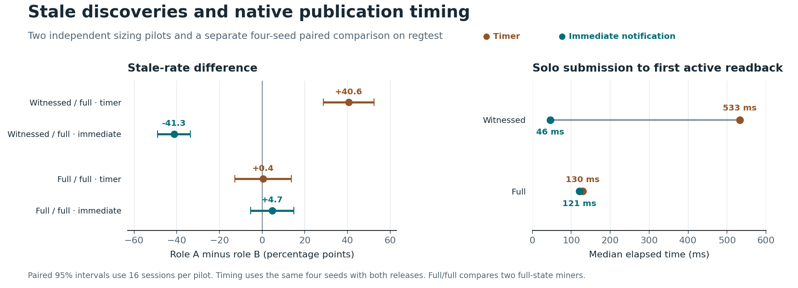

# Prospective production workload comparison

Use separate cohorts for sizing and estimation. The independent sampling unit is a session with fresh node volumes, fresh funding and a randomized assignment of miners to links. Fix the opportunity schedule before waiting for node readiness. Log each scheduled parent, both miners' ready flags and reasons, hash attempts, discoveries, tied discoveries, exact solved bytes, independent receivers' arrival times and their active hashes at depth two. A missed opportunity remains in the ledger. Continue tracking settled blocks that subsequently leave the chain.

Run both witnessed-versus-full and full-versus-full controls in each session with matched hash attempts and propagation conditions. Give each miner its own native publication path and independently queried receiving nodes. Randomize sides and traffic order. Send background payments independently of the opportunity schedule. Record feed loss, checkpoint and candidate latency, receiver disagreement and transport retries. Save release binary hashes and capacity limits with every session.

The primary estimate is the difference in stale discoveries divided by discoveries for each miner, with a paired session-level interval. Report availability, discoveries per scheduled opportunity and settled discoveries per scheduled opportunity alongside it. The control estimates asymmetry between paths. Predeclare a two-sided 95% interval with half-width at most one percentage point for the primary difference. Use 16 independent pilot sessions to estimate between-session variance, then freeze the number of fresh evaluation sessions. For equal session sizes use the ceiling of the squared ratio of the pilot standard deviation times the appropriate Student-t critical value to 0.01. For unequal discovery counts use the session-level influence values of the ratio estimates. Keep both arms of each session together in resampling. Publish the actual interval and label precision inconclusive if the planned precision was missed. Publish exclusions, incomplete sessions, and disagreements.

Alpha.3’s 1,024 opportunities came from ready miners through a common relay. Those measurements remain the result of that experiment. The independent-receiver cohort requires its own ledger. [Prior result and limits](reliability-results.md)

## Native SV receiver cohort

The executable cohort assigns one independent SV Node v1.2.3 receiver to each lane. Those receivers connect to one another. A stock SV miner connects separately to each receiver. The witnessed miner replaces the left stock producer in half of the opportunities and delivers through its direct SV P2P path. Reverse the physical assignment by session seed. The two full nodes and their receiver links support the full/full control. The separate mixed-node proof measures one candidate on SV and native Teranode paths. This sampling topology measures native SV-P2P outcomes on a single workstation.

For the sizing pilot use seeds 41001 through 41016, 32 parent opportunities per session and a 1,200 ms delay after offering each common signed payment. Shuffle the 16 witnessed/full and 16 full/full opportunities in each session before funding. Record both miners' availability and hash the ready jobs in disjoint nonce lanes at equal attempts per logical tick. Submit every first-tick discovery to its own producer. In a tie a barrier releases both calls. Independently poll the two receiver tips. The continuation miner is drawn before the race. It builds to depth two on the tip it actually selected. Read both active ancestries after depth two and again at the end of the session. An unavailable job earns zero attempts. A discovered block that misses native publication stays in the discovery denominator. Fresh evaluation seeds start at 51001 and use the same session design.

The common-payment workload submits a newly signed payment on every opportunity. The full references receive the common 105-block setup before the witnessed process joins. Client timings bound active-tip observation after submission. The run records CPU-worker results and the host's local links. Independent background traffic, geographically distributed receivers and physical ASIC performance require separate measurements.

```sh
.native/py/bin/python qualification/native_cohort.py .native/session.json --seed 41001
```

Run the sizing sessions serially to avoid competition between cohort sessions on the host. Keep the sizing data and evaluation data in separate directories. Each completed compressed receipt includes every scheduled exposure, candidate bytes for each discovery, both native submission outcomes and both receiver readbacks. Interrupted attempts retain their partial ledger. The estimator pools the two discovery ratios and computes paired influences per session. The confidence interval uses the Student-t critical value with session-count minus one degrees of freedom.

```sh
.native/py/bin/python qualification/run_cohort.py .native/pilot --phase pilot > .native/pilot-summary.json
.native/py/bin/python qualification/run_cohort.py .native/evaluation --phase evaluation \
  --pilot-summary .native/pilot-summary.json > .native/evaluation-summary.json
```

The full nodes import fixture history before opening the cohort peer links. In sizing session 41007 a simultaneous native header arrival during the original fixture import returned `duplicate-inconclusive` before the entrant started. That attempt contained zero scheduled opportunities. The unchanged session seed was rerun after serializing these setup steps. The node binary, opportunity schedule, receiver links and analysis are identical across completed sizing sessions.

In the original sizing pilot, the witnessed producer was ready on 18/26 sampled parents among the first four opportunities of each session and 208/230 among the remaining opportunities. Of the 22 later misses, 15 reported missing newer announced bodies and seven lacked an eligible common-payment job. The full competitor was ready throughout. This distinguishes transient body coverage and template availability from the effect of relay latency on an already discovered block. [Original pilot and sizing](evidence/chronicle-native-sizing.json)

The separate propagation-control method gates native bytes on four isolated paths and bounds arrival at each receiver with a TCP-ordered ping. It is intended for the question about equal propagation. The two registered native studies retain their end-to-end publication paths. [Design, bounds and future qualification](propagation-control.md)

## Publication latency comparison

The frozen engineering pilot sized the fresh evaluation at 2,263 sessions. Both phases retain the same measured executable. A separate experiment tests the one-second SV publication poll against an otherwise matched executable with immediate notification after durable solve. Run four independently initialized pairs with seeds 62001–62004, 32 opportunities per session, alternating which build runs first. The native fixtures and opportunity semantics are identical. Preserve both control arms and all ties, missing jobs and sole discoveries. Report earliest independent active-tip observation over the receivers, conditional on a solution being observed. Timing includes polling and native ingress. Each process identifies the tested binary by digest. A local scheduling lock prevents these comparison sessions from overlapping the primary cohort.

```sh
.native/py/bin/python qualification/relay_comparison.py docs/evidence/chronicle-native-pilot
.native/py/bin/python qualification/relay_comparison.py .native/relay-comparison \
  --timer "$POLLED_BINARY" --immediate "$NOTIFIED_BINARY" > .native/relay-comparison.json
```

### Measured publication behavior

Four independently initialized seed pairs produced 256 scheduled opportunities across the two builds. All eight sessions closed with matching depth-two and session-final readbacks on both receivers. Every competitive header, assigned nonce lane, proof of work, Merkle root and common payment can be checked from the receipts. The new build wakes an already connected SV peer sender after durable solve. Both builds include the periodic retry path.

| Build and producers | Ready per 64 scheduled, left / right | Stale per discovery, left / right | Settled per 64 scheduled, left / right | Stale difference, percentage points (95% interval) |
|---|---|---|---|---|
| Timer, witnessed / full | 56 / 64 | 19/42 and 2/43 | 23 / 41 | +40.6 (−0.2 to +81.4) |
| Immediate, witnessed / full | 56 / 64 | 0/37 and 11/38 | 37 / 27 | −28.9 (−40.8 to −17.1) |
| Timer, full / full | 64 / 64 | 12/48 and 10/38 | 36 / 28 | −1.3 (−58.2 to +55.6) |
| Immediate, full / full | 64 / 64 | 9/38 and 10/45 | 29 / 35 | +1.5 (−27.7 to +30.6) |

All sole discoveries settled. Under the timer, the witnessed producer won 2 of 21 simultaneous discoveries. With immediate wake it won 11 of 11. The witnessed sole-discovery median time from the pre-job sampling point to the first polled receiver reporting its block fell from 540 ms to 59 ms. The full competitor measured 144 ms and 132 ms. Starting the clock at the actual native submission gives 533 ms and 46 ms on the witnessed path, compared with 130 ms and 121 ms on the full path. The witnessed worker received its local acknowledgment in a median of 12 ms under both builds. Polling starts after the local submission calls return, so these are upper bounds on first active-tip adoption. The receivers' packet arrival times are unknown. The Scary producer reaches its receiver through a published Docker host port. Both stock producers run inside the Docker network. Randomizing the receiver identities preserves that host-to-VM difference.

The change in the witnessed-minus-full stale difference was −69.5 percentage points. A paired session-level delta-method interval using three degrees of freedom spans −118.6 to −20.4 points. The full/full change was +2.8 points (−44.1 to +49.6). A difference of two risk differences can exceed 100 points in magnitude. The paired intervention implicates the delay between a durable solve and native announcement as a cause of the measured disadvantage on this host. The four seeds had different coinbases, jobs and solved hashes on their two runs, so they generated different tie counts. The competitor's native path had a higher measured median after the change, and the corrected result includes eight unready witnessed opportunities. These observations cannot establish equal orphan risk with matched network propagation or under mainnet latency.

Use stock Python 3 to verify the raw records and regenerate the comparison. Each arm in the summary identifies the measured executable by SHA-256. [Raw paired sessions](evidence/chronicle-relay-comparison) · [Paired summary](evidence/chronicle-relay-comparison.json)

```sh
python3 qualification/relay_comparison.py --paired docs/evidence/chronicle-relay-comparison > /tmp/scary-relay-comparison.json
cmp /tmp/scary-relay-comparison.json docs/evidence/chronicle-relay-comparison.json
```

## Corrected executable cohort

The corrected-build study uses the same local topology, common-payment workload, balanced randomized arms, 1,200 ms sampling delay and depth-two settlement as the original. Freeze independent sizing seeds 71001–71016 before collection. Use 16 sessions of 32 opportunities for sizing and the same one-percentage-point precision formula. Begin the fresh evaluation at seed 81001 and run exactly the sample size returned by this pilot. Exclude every engineering-comparison and sizing observation from the fresh estimate. The two original study phases keep their own executable and seeds. Each phase uses the same binary digest as its own sizing pilot. The measured immediate-wake executable for this run has SHA-256 `2d3a2d351ad55ce203a2c50d7394e9d6353e9136b0f4cf9179f9b961274b80b7`.

Include every scheduled parent in availability and yield. Show the first four sampled parents separately from the remaining 28 in each session. Three blocks advance the common parent between opportunities, so the first four sample the first twelve blocks after witnessed funding. The lab uses its existing regtest readiness settings throughout. Report missing jobs and recorded reasons in each stratum. Continue retaining all of those rows in the primary estimate. Local native routes, a CPU nonce worker, a one-payment workload and the short cold-start session shape define the population to which these results apply.

```sh
.native/py/bin/python qualification/run_cohort.py .native/immediate-cohort --study immediate \
  --phase both --binary "$NOTIFIED_BINARY"
python3 qualification/cohort_estimate.py .native/immediate-cohort/evaluation --study immediate \
  --phase evaluation --pilot-summary .native/immediate-cohort/pilot-summary.json
```

The combined command writes a timestamped registration before the first session, verifies saved receipt identities on resume, and publishes the evaluation summary once the last planned session closes. The published [registration](evidence/chronicle-immediate-registration.json) identifies the executable measured on this workstation.

### Closed immediate-wake sizing pilot

All 16 registered sessions closed with 512 scheduled parents and zero setup retries. The witnessed lane was ready on 227 of its 256 parents. Fourteen misses occurred while newer bodies were outstanding and fifteen while a common-payment job was unavailable. Both full-state control lanes were ready on all 256 control parents. The table reports depth-two stales divided by discoveries, with paired 95% intervals across the 16 fresh sessions. [Lossless session archive and calculations](evidence/chronicle-immediate-pilot/manifest.json) · [Counts for each session and lane](evidence/chronicle-immediate-pilot/sessions.csv)

| Sizing arm, left / right | Left stale / discovered | Right stale / discovered | Left minus right (percentage points) |
| --- | ---: | ---: | ---: |
| Witnessed / full | 3 / 154 | 80 / 185 | −41.30 (−48.95 to −33.64) |
| Full / full | 40 / 161 | 34 / 169 | +4.73 (−5.35 to +14.80) |

The primary session influence standard deviation was 0.143741. The preregistered sizing formula fixes the separate immediate-wake evaluation at **939 fresh sessions**, or **30,048 scheduled parents**, starting at seed 81001. The strong difference in this sizing sample applies to the measured native publication paths on this workstation. Matching receiver ingress and qualifying a new release each require their own experiment. [Frozen sizing output](evidence/chronicle-immediate-sizing.json) · [Study registration](evidence/chronicle-immediate-registration.json)

## Closing and auditing a fixed-size phase

The archive exporter checks the exact registered session filenames before reading race outcomes. It preserves every complete raw receipt in deterministic gzip shards of up to 128 sessions. The accompanying CSV gives the scheduled opportunities, readiness, hashes, discoveries, settlements, stales and later detachments for each lane in each independent session. A measured partial or an unclassified attempt holds the export open. The manifest includes every retained setup retry and its original zero-row receipt.

The offline verifier regenerates the schedule and physical link orientation from each seed, checks the reference image and binary digest, decodes the full solved blocks, verifies proof of work and Merkle commitments, and checks both receivers’ depth-two and session-final ancestors. For a successful lane it also rehashes all preceding nonces on the recorded winning work. A lane with no discovery records its effort and readiness. Its unsuccessful candidate header is unavailable for independent rehashing in these fixtures.

For the primary difference, pool stale and discovered counts by role, compute the paired influence of each whole session, then take the Student-t interval across sessions with one degree of freedom consumed. The archive also calculates paired intervals for readiness, discoveries, settlements and stales per scheduled opportunity. Unready lanes contribute a zero to the event count and one to the scheduled denominator. A missing discovery denominator leaves the conditional comparison and its sizing undefined. The full/full arm uses the same calculations. The one-point target applies to the witnessed/full primary difference. Report the achieved interval after the complete fresh sample, even if its half-width exceeds the target. A finite confidence interval quantifies uncertainty about a difference under the measured topology.

```sh
python3 qualification/cohort_archive.py export docs/evidence/chronicle-native-pilot \
  .native/original-pilot-archive --phase pilot
python3 qualification/cohort_archive.py verify .native/original-pilot-archive

python3 qualification/cohort_archive.py export "$STUDY/pilot" \
  docs/evidence/chronicle-immediate-pilot --phase pilot \
  --registration docs/evidence/chronicle-immediate-registration.json
python3 qualification/cohort_archive.py export "$STUDY/evaluation" \
  docs/evidence/chronicle-immediate-evaluation --phase evaluation \
  --registration docs/evidence/chronicle-immediate-registration.json \
  --pilot-summary "$STUDY/pilot-summary.json" \
  --pilot-archive docs/evidence/chronicle-immediate-pilot
python3 qualification/cohort_archive.py verify docs/evidence/chronicle-immediate-evaluation
```

### Restart between fixed evaluation sessions

On November 22, 2026 UTC, the three evaluation writers stopped while a separate sustained workload held the workstation. The original relay study had sealed 1,006 of 2,263 sessions, the immediate relay study 39 of 939, and the matched-ingress study 12 of 6,765. Each had a contiguous prefix and zero open evaluation ledgers. Together those prefixes contain 33,872 scheduled parents. The resumed writers verified the existing files and continued from each study’s next scheduled seed, with its original executable and fixture. The sample sizes and inclusion rules stayed fixed. [Outcome-blind commitments to the three prefixes](evidence/chronicle-cohort-resume.json)

To verify a prefix, supply its original evaluation directory or the completed study’s public shard directory. The check authenticates every complete session object in seed order and reads only the specified prefix. The final phase analysis uses the full registered sample.

~~~sh
python3 qualification/cohort_prefix.py docs/evidence/chronicle-cohort-resume.json original "$ORIGINAL_EVALUATION"
python3 qualification/cohort_prefix.py docs/evidence/chronicle-cohort-resume.json immediate "$IMMEDIATE_EVALUATION"
python3 qualification/cohort_prefix.py docs/evidence/chronicle-cohort-resume.json matched "$MATCHED_EVALUATION"
~~~

## Registering a different release

Changes to publication or readback timing can alter the time until the next worker job. For example, commit `af9b605` adds active-header readback after sending a solution. Register each materially different executable as a new experiment before sampling. Keep the original and immediate-wake studies on their original binaries.

Choose an unused positive namespace from the published registrations, build the intended release, and retain its executable at a dedicated path. The registration records the actual binary digest, nominated release commit, measurement harness commit and file digests, Python version, reference image, pilot size, evaluation sizing rule and seed allocations. Each namespace reserves 2³² consecutive seeds above the legacy studies. Pilot seeds occupy the first 16 positions after the base. Fresh evaluation begins at the next position. Publish the registration before running the following second command; the runner also stores a local copy and resumes only from matching receipts.

```sh
.native/py/bin/python qualification/cohort_registration.py register \
  --namespace "$UNUSED_NAMESPACE" --release-commit "$RELEASE_COMMIT" --binary "$FROZEN_BINARY"

.native/py/bin/python qualification/cohort_registration.py run \
  "docs/evidence/chronicle-release-${UNUSED_NAMESPACE}-registration.json" \
  "$NEW_STUDY" --binary "$FROZEN_BINARY"
```

The runner uses the existing native experiment and the same workstation session lock. After session 16 it writes the sizing summary and starts exactly the calculated number of fresh evaluation sessions. For a new release, use its registration with the export commands above and give the verifier its corresponding pilot archive.

## Simultaneous Stratum workers

One Scary process accepts independent TCP Stratum sessions while two stock SV receivers follow the same regtest branch. Each authenticated CPU worker checks its own extranonce, constructs a coinbase, and hashes two successive templates for one parent. The first job contains a witnessed payment. A second payment triggers a same-parent refresh. Every worker submits a known below-target share, then all release different network-target solutions from a barrier. Successive rounds assign everyone to the earlier job, everyone to the refreshed job, or half to each. Exactly one accepted solution per parent must match the winning worker's reconstructed header, coinbase and ordered payments. Both SV nodes supply its full bytes and headers for two successors. The node's local solution record supplies the job identifier and settlement transition.

The regtest share target equals the network target. Accepted shares in this fixture produce blocks. The deliberately simultaneous submissions test job handling under contention. ASIC hash rate, ordinary sub-block shares at mainnet difficulty, and production stale frequency require different measurements.

```sh
.native/py/bin/python qualification/native_workers.py .native/workers.json.gz \
  --binary target/release/scary-node --workers 32 --rounds 12
python3 qualification/verify_native_workers.py .native/workers.json.gz
```

Each release completed 12 parent rounds with 32 simultaneous workers. For each executable the ledger contains 384 authenticated sessions, 384 below-threshold share rejections, 384 distinct target-valid submissions, 12 accepted solutions, and 372 explicit stale-work responses after another worker won. No worker lost its reply. The two SV receivers agreed on all 24 depth-two readbacks per build. The first job won six rounds on the identity-fenced executable and seven on the revised template-sharing executable. These counts reflect the planned contention scenario. [Identity-fenced release receipts](evidence/chronicle-workers-32.json.gz) · [Template-sharing release receipts](evidence/chronicle-workers-32-revised.json.gz)

A separate test kept one worker connected while 16 further signed payments produced 16 new templates for the same parent. New authenticated connections independently read each revision. On release binary `910e079650b504d6733d00e542c1f973acb13853c7972546a30c278345981320`, the original worker received all 17 notifications. Each of its 16 below-target shares on the first job returned the expected difficulty error. Its network-target share on that same job produced block `4c2c80e91392bc444021a318ae70dc97a9f20028f9b990d162c384f6335634a0` containing exactly its original payment. Both SV nodes served identical bytes, and independently returned its active hash after two successors. [Retained-job receipt](evidence/chronicle-retained-job.json.gz)

```sh
.native/py/bin/python qualification/retained_job.py .native/retained.json.gz \
  --binary target/release/scary-node --refreshes 16
python3 qualification/verify_native_workers.py .native/retained.json.gz
```



The pilots used independent seed ranges. The paired timing comparison used the same four seeds with both executables. On that comparison the full-state miner’s median solo submission-to-active interval moved from 130 to 121 ms, while the witnessed miner’s moved from 533 to 46 ms. The full/full pilot intervals include zero. The matched-ingress study measures stale discoveries when the arrival of the competing block bytes is independently bounded. [Timer sizing receipt](evidence/chronicle-native-sizing.json) · [Immediate-notification sizing receipt](evidence/chronicle-immediate-sizing.json) · [Paired timing measurements](evidence/chronicle-relay-comparison.json) · [Figure reproduction](../qualification/plot_native_pilots.py)
