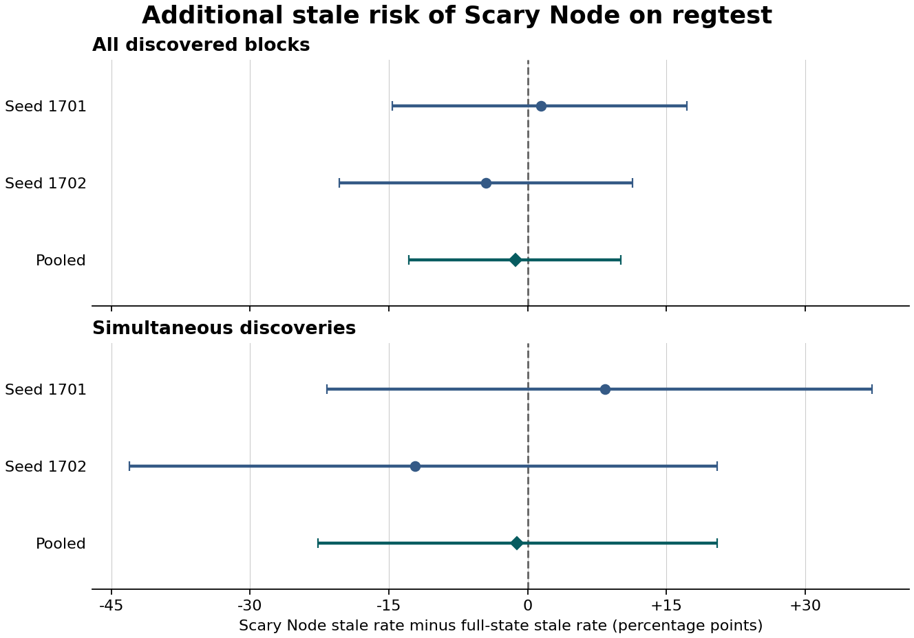

# Does witnessed-input mining add stale risk?

Across 256 regtest opportunities, Scary Node lost **44/175 (25.14%)** of its discovered blocks. The full-state Teranode miner lost **45/170 (26.47%)**. The estimated additional stale risk was **−1.33 percentage points**, with a paired 95% bootstrap interval of **−12.81 to +10.06 points**.

The upper panel resamples complete mining opportunities within each session. The lower panel uses exact binomial intervals for the difference conditional on simultaneous discovery. Positive values mean Scary Node lost more often.

## Stale rates per discovered block

| Session | Opportunities | Single discoveries | Simultaneous discoveries | Scary stale / discovered | Full-state stale / discovered | Difference (pp) | 95% paired interval (pp) |
| --- | ---: | ---: | ---: | ---: | ---: | ---: | ---: |
| 1701 | 128 | 80 | 48 | 26/93 (27.96%) | 22/83 (26.51%) | +1.45 | −14.66 to +17.21 |
| 1702 | 128 | 87 | 41 | 18/82 (21.95%) | 23/87 (26.44%) | −4.49 | −20.36 to +11.33 |
| Pooled | 256 | 167 | 89 | 44/175 (25.14%) | 45/170 (26.47%) | −1.33 | −12.81 to +10.06 |

Each role performed **334 header hashes**. A miner that missed the target on the stopping tick had no discovered block to lose. There were 167 single discoveries and every one survived. The two rate denominators differ because equal numbers of hashes can yield different numbers of successes. The conservative simultaneous binomial bound for the pooled rate difference is −16.71 to +14.08 percentage points under the common conditional-rate model.

## What happened to valid siblings

Both miners discovered a valid block on 89 of 256 stopping ticks (34.77%). Scary Node lost **44/89 (49.44%)** of these races and the full-state miner lost **45/89 (50.56%)**. The conditional difference is **−1.12 points**, with an exact 95% interval of **−22.67 to +20.50 points**.

| Proxy arrival on simultaneous discoveries | Scary survived | Full-state survived |
| --- | ---: | ---: |
| Scary in earlier millisecond | 3 | 1 |
| Same millisecond | 42 | 41 |
| Full-state in earlier millisecond | 0 | 2 |

Both roles used the same RPC path and relay. Median signed ingress skew (Scary minus full-state) was 0.0 ms. The 95th percentile of the absolute ingress skew was 1.0 ms. At the client, the 95th percentile of the absolute dispatch skew was 0.138 ms. Same-millisecond arrival bins leave finer ordering unresolved. When the experiment queued Scary’s relay worker first, Scary survived 24/41 races. When it queued the full-state worker first, Scary survived 21/48. Queue order was randomized independently of nonce lanes.

Median candidate sizes were 382 bytes for Scary Node and 382 bytes for Teranode. Each pair spent the same witnessed outpoint through the same signed payment at a fee of 1,000 regtest satoshis. The coinbases and block identifiers were specific to the miners.

The judge served every discovered block byte for byte. Of the 89 inactive siblings, 80 were indexed as fully validated forks and 9 as stored branches with valid headers. All passed the common-parent proposal check, including the latter group. Offline replay independently checked the header work, Merkle commitment, source, amount and signature. The raw submit RPC returned null 256 times and inconclusive 89 times. Each outcome came from the recorded active branch through two subsequent blocks.

## Interpretation

The measured rates are compatible with zero additional stale risk for witnessed-input selection under these conditions. The primary interval also admits an increase as large as 10.06 percentage points. The experiment specified no equivalence margin. It had insufficient precision to establish exact equality or rule out smaller increases in risk.

The two Teranodes, Rust process and independent SV Node ran on one Docker host. Scary Node joined at height 101, after the reference databases already held the chain from genesis. Both miners were ready on the same parent and chose the same valid spend. This controls transaction content while comparing two implementations with distinct coinbases and jobs. A common receiver chose the winner, then the original producer published the selected solution natively and two miners extended it. The experiment measures staleness at that receiver under synchronized work and common ingress. The branch readbacks substantiate settlement. Job availability, differing transaction choices, native relay over multiple routes, and how often mainnet miners actually race lie outside this measurement.

## Receipts and reproduction

Each formal session began on fresh volumes, ran all 128 scheduled opportunities and ended at height 487. The initial engineering pilot stopped after one settled opportunity when a sibling produced an inconclusive RPC return. The corrected seven-opportunity pilot completed on a fresh chain. Both engineering runs preceded enrollment. The two formal receipts preserve every scheduled opportunity and every on-target discovery. [Seed 1701 receipt](evidence/races-1701.json.gz) · [Seed 1702 receipt](evidence/races-1702.json.gz) · [Run the lab, replay receipts and regenerate the graph](races.md)

Before each teardown, a separate RPC readback checked the active ancestor at every trial height and two blocks later on all three full nodes. The judge still served all 89 inactive siblings. Both runs used the same Rust executable (SHA-256 `0a439bfe313c1cb7354332e3811ef258ce008ad142870f440932ac13570ce27d`). Docker reported identical platform image manifests (`a8d173159f01f4adea5758f851ff5ea6a8d3a6d90eee43b1e6d21bd176e12d0a`). The two local image-list identifiers in the receipts differ because each build generated its own provenance attestation.
