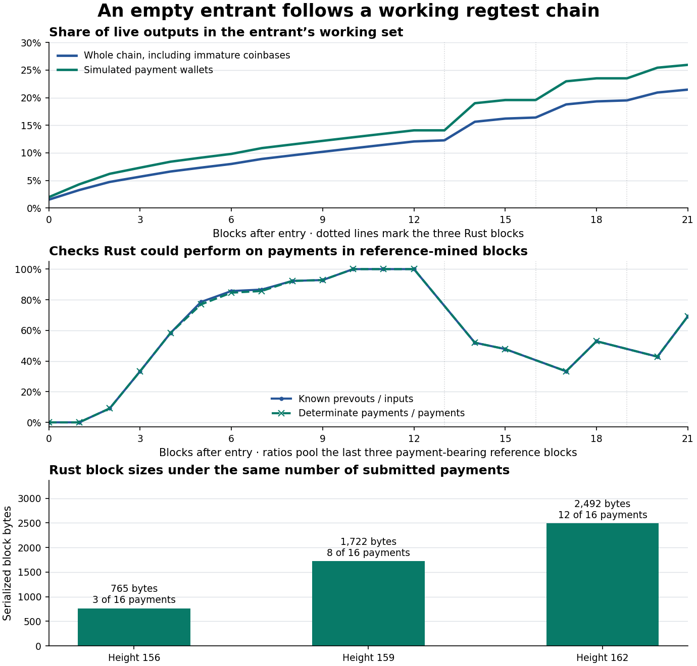

# What an empty miner learns on an active chain

In each of two fresh regtest runs, the entrant joined at height 143, followed twelve more reference blocks and then mined with a partial working set. The same 16 accounts each offered a new payment at every mining opportunity. Rust included **3, 8 and 12 payments** in its three blocks. Both Teranodes adopted each candidate and served its exact bytes. A reference miner extended each one. At the last tip the entrant knew **97 of 452 live outputs (21.5%)**. It could still independently check every payment in that particular reference block.

The figure follows seed 7. The middle panel pools numerator and denominator over up to three recent payment-bearing reference blocks, excluding Rust’s own blocks. The tables below use exact counts at the named heights.

## What was already on the chain

At entry, **105 of 320** historical payment transactions had no live outputs. **210** had some live outputs, and **5** still had all their outputs. Thus **215 transactions** in this interval belonged to the still-live category. The 320 payments had created **533 outputs**, of which **218** remained live at entry. The experiment measures exactly which outpoints still existed at that height. Running an archive-deletion policy would be a different experiment.

## How much the entrant learned

| Chain position | Whole-chain UTXOs witnessed | Wallet UTXOs witnessed | Witnessed UTXOs eligible for the next job |
| --- | ---: | ---: | ---: |
| Entry, height 143 | 6 / 396 (1.5%) | 5 / 254 (2.0%) | 0 |
| First job permitted, height 155 | 52 / 431 (12.1%) | 39 / 277 (14.1%) | 33 |
| Final shared tip, height 164 | 97 / 452 (21.5%) | 75 / 289 (26.0%) | 70 |

The entrant processed the three payments in its entry body with zero known input outpoints. Over the next twelve reference blocks, **42 of 53 inputs** came from outputs Rust recognized. It reached a determinate result for **41 of 52 payments** under the modeled checks. The gate then opened with 13 contiguous bodies. Its process trace starts at 143 and ends at 164, with each of the 22 heights observed once and zero coverage resets. The genesis-to-tip replay ran in the separate verifier.

The proportion of reference payments Rust could check varied with traffic. At height 155 it checked all four payments. At 157 the reference miner included payments Rust had deferred and new wallet traffic. Rust could check **4 of 16** payments in that block. Growing the working set increases opportunities without guaranteeing that any particular next block spends familiar coins.

## Six accepted Rust blocks

The third job included nine more payments than the first despite identical offered demand. Its serialized block grew by 1,727 bytes in seed 7 and 1,724 bytes in seed 19. Each Teranode independently served the matching body from its active chain. The immediate successor collected every valid offer Rust had deferred.

| Rust block height | Payments offered | Payments mined by Rust | Deferred and mined by next reference | Rust fees (satoshis) | Seed 7 bytes | Seed 19 bytes |
| --- | ---: | ---: | ---: | ---: | ---: | ---: |
| 156 | 16 | 3 | 13 | 3,000 | 765 | 766 |
| 159 | 16 | 8 | 8 | 8,000 | 1,722 | 1,723 |
| 162 | 16 | 12 | 4 | 12,000 | 2,492 | 2,490 |

At the first job Rust lacked creating outputs for twelve offers. It had seen the thirteenth output in the latest block and required a successor before spending it. At the next two jobs every deferral arose from an unseen output. Of 48 offers per run, Rust collected 23,000 satoshis of regtest fees and left 25,000 for the references. These figures quantify the cost of its admission policy for this traffic.

## Same block, different histories

At height 164, the established entrant and a fresh Rust observer received the identical reference-mined block, with the same three payment inputs and executable. The fresh observer had first seen the parent at 163. Each process saw two native peers and reported zero coverage resets.

| Measurement on height 164 | Established entrant | Fresh observer |
| --- | ---: | ---: |
| Complete bodies witnessed since entry | 22 | 2 |
| Live outputs tracked at this tip | 97 | 16 |
| Known inputs / payment inputs | 3 / 3 | 0 / 3 |
| Successful Script checks | 3 | 0 |
| Payment amount checks | 3 | 0 |
| Determinate / deferred payments | 3 / 0 | 0 / 3 |

The matched block was valid. Both processes checked its header and transaction commitment. The established observer also had the source scripts and amounts for all three payments. The fresh observer depended on its accepted-history premise for those inputs. The two processes’ status rows and the independent replay agree on the difference.

A separate offline control isolates the ability to identify an invalid amount. Two Rust observers reached the same parent, one through thirteen bodies and one through its entry body. Their read-only check received identical signed payment bytes. The source held 100,000 satoshis and the payment attempted to create 100,001. The longer-running observer checked the signature and rejected the excess satoshi. The fresh observer lacked that source, performed zero Script checks and deferred the amount decision. Neither working set changed. A separate block-processing test verifies that a known amount violation rolls back earlier transactions in the body. [Reproduce the matched payment and rollback checks](scenario.md#verify-the-shipped-records)

The local controls show a concrete reason to reject a subsequent spend. At height 149, Rust deferred a genuine payment from a pre-entry savings outpoint. A reference mined it at 150. Rust then classified an attempted **reuse of the exact same signed bytes** as invalid because it had witnessed the outpoint being consumed. The original payment remained valid. For a two-input payment, Rust checked the signature of the witnessed input and deferred the amount check while the other input was unknown. A further payment used a predecessor created earlier in the same block. These cases measure the difference between unknown, checked and definitely consumed. [Validation implementation](../src/mining/validation.rs) · [Local block rejection and recovery tests](../src/mining/tests.rs)

## Experimental design

Two reference Teranodes start at regtest genesis and alternate mining. Maturity blocks make the first wallet coinbase spendable. A distribution transaction then funds background payment balances, sixteen cash accounts and savings balances. Four temporary wallets sign real P2PKH payments at a fixed fee of 1,000 satoshis per payment. Background payments rotate recipients and often return change. During the forty history blocks, eight payments are mined per block. Both references maintain spendable state throughout.

Rust first appears after this history, with a new identity and empty working state. It receives the current tip over native Teranode gossip, fetches its body, then follows twelve new payment-bearing reference blocks. At each of three mining opportunities the same sixteen accounts pay once. Each uses its oldest deposit, and recipients place the new deposit at the back of the account’s queue. Four accounts also transact during the observation interval. Other accounts start with one, two or three older deposits. Recipients vary by seed. This fixes the number of offers but allows the fraction Rust has evidence for to change.

The driver submits every mining offer to a reference and to Rust. A CPU Stratum worker hashes Rust’s own job. The proof checks native publication, matching serialized bodies served by both Teranodes, active-chain inclusion and an independently mined successor containing the valid deferred offers. The matched comparison at the end gives an older and a newly arrived Rust observer the exact same reference block. [Workload and reproduction](scenario.md) · [Driver](../regtest/scenario.py) · [Independent verifier](../regtest/verify_scenario.py)

## Verify both runs

Each receipt contains the serialized genesis block through height 164. Independent replay verified 165 blocks, 442 non-coinbase transactions and 443 input signatures in each run. It reconstructed the full UTXO inventory and the two narrower observation histories. Seven altered-receipt tests per seed checked that changes to bodies, counters, participant evidence or agreed hashes fail verification. Both observers in both runs used the Rust executable with SHA-256 `0a439bfe313c1cb7354332e3811ef258ce008ad142870f440932ac13570ce27d`. The receipts identify all six distinct Rust blocks and their successors. [Seed 7 receipt](evidence/scenario-7.json.gz) · [Seed 19 receipt](evidence/scenario-19.json.gz) · [Commands to replay or run from scratch](scenario.md)

## Interpretation

“Fully spent” here means that none of a historical payment’s outputs remain live at entry. “Partly spent” leaves some outputs live, and “wholly unspent” leaves all live. These categories describe the 320 payments in the designated history interval. The initial distribution, entry block and coinbases have separate roles in the chain-wide counts.

The entrant learns an output from its creating block and checks for its subsequent consumption. An old payment rolling over creates a new outpoint, so turnover can expand the entrant’s usable set without disclosing the original input’s amount or script. A quiet old balance can stay invisible indefinitely. When the entrant observes a consuming input, it has evidence against using that outpoint again on the same accepted branch, even if the creation predates entry.

The idle change outputs and untouched maturity coinbases enlarge the whole-chain denominator. Consecutive background blocks rotate through different payment lanes, making the final cold observer unlikely to know the next block’s input creations. The fixed fee, credit depths, P2PKH-only payments, block target, number of operators and arrival schedule define the scope of the result. Seed changes exercise fresh signatures, destinations, hashes and independent runs of the software. Mainnet’s distribution of wallet activity would need a separate sample. The experiment measures actual block bytes, live output coverage and local decisions. Mainnet stale rates, hardware costs, throughput and the consequences of deleting a particular archival database require separate measurements.
