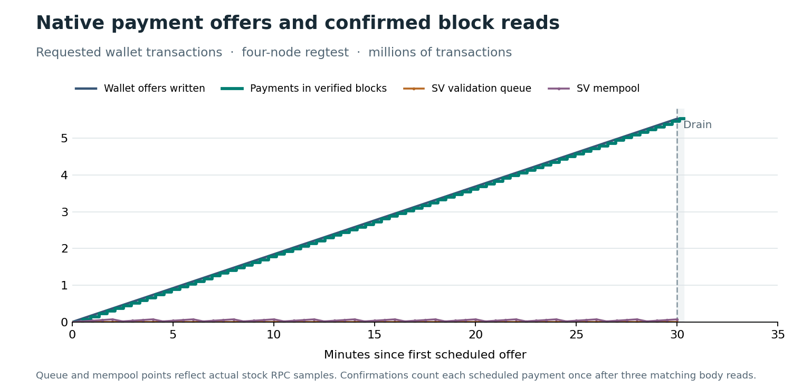

# Prospective native inventory and production-settings replication

## Question and registration

Can the same witnessed-state release, native routes and funded payments meet the 3,000 confirmed payments/s target when a stock mainnet-style relay first requests the transactions? This is a separately enrolled replication on isolated regtest. The [first native wallet trial](sustained-native-trial.md) retains its registered direct Bitcoin transaction-message intake, stock regtest settings, wallet sends, lost work and complete time denominator.

Each trial uses the same signed 5,529,600 distinct payments over 1,800 seconds, 512 per batch, six batches per second across four ordinary wallet peer connections. The exact common h484 funding block is `3fb3a456448fd6d91801a35c04112ffab3f30dc0a6a14e426effff4f91660ba9`. The SHA-256 of the ordered internal transaction IDs is `243170edb3df9bea289c32207732d988f6e4b92f67b17634a72e709ae8b735a2`. The 65,536 ordinary payment rails, rotation among eight signing keys and byte-identical parents come from the published paired workload. The entrant joins before the h451 funding and observes every subsequent setup body. Every stock node independently validates the archived setup beginning at genesis. The Linux Scary Node binary must hash to `833fbeecc17a45de9edc8777123708ecd2e390d522c436b867a74a208318a528`. Use independent, newly initialized stock SV, Scary Node and two Teranode data volumes and two independent Aerospike databases in the dedicated `scary-node-sustained-production` Compose project. Reserve the same workstation and Docker backing store headroom as the first trial and hold the same session lock. No other measured regtest cohort runs concurrently.

## Production settings and native payment path

SV Node v1.2.3 normally performs a full mempool consistency walk after each transaction on regtest. This independently documented additional diagnostic incurs quadratic work as the pending pool grows. Set `-checkmempool=0 -checkblockindex=0` to match the reference implementation's mainnet diagnostic defaults. Its script, input, UTXO, policy and block validation remain active. The regtest Chronicle activation and low PoW target remain identical in both runs. [SV Node initialization](https://github.com/bitcoin-sv/bitcoin-sv/blob/6504a3aff65ba97c0f6c80962b033e35ecbfed4b/src/init.cpp#L2339-L2351) · [Mempool complexity](https://github.com/bitcoin-sv/bitcoin-sv/blob/6504a3aff65ba97c0f6c80962b033e35ecbfed4b/src/txmempool.h#L425-L429)

Set the stock SV excessive block parameter to 4,000,000,000 bytes, matching the Teranode legacy relay's advertised EB4000.0. SV calculates its transaction inventory retrieval allowance from this setting. Its maximum grows from 700 per retrieval at 20 MB to 140,000 at 4,000 MB. Message-size negotiation still applies. Its default 150 ms inventory-broadcast delay and normal peer validation remain enabled. Record the arguments and actual peer traffic. Leave the Scary Node binary, stock images, mining policy, wallet payment values and fees, original network routes, and Aerospike storage configuration at their previous values. [SV inventory sizing](https://github.com/bitcoin-sv/bitcoin-sv/blob/6504a3aff65ba97c0f6c80962b033e35ecbfed4b/src/net/net_processing.cpp#L513-L518) · [SV queue retrieval and framing](https://github.com/bitcoin-sv/bitcoin-sv/blob/6504a3aff65ba97c0f6c80962b033e35ecbfed4b/src/net/net_processing.cpp#L5539-L5556) · [SV broadcast interval](https://github.com/bitcoin-sv/bitcoin-sv/blob/6504a3aff65ba97c0f6c80962b033e35ecbfed4b/src/net/net_processing.h#L17)

Each due wallet batch advertises its transaction IDs in Bitcoin P2P `inv` messages. Each wallet serves the original signed `tx` bytes in response to stock SV `getdata`. Retain the four initial connections through the drain, count requests, bodies served, repeated requests, reconnects and reject messages. Distinguish a successfully written inventory advertisement, an actual requested transaction body and a confirmed payment. Wallet transactions enter only the stock SV peer. Scary Node obtains them through its native peers. Both stock Teranodes and their two UTXO stores validate normally. Instrument the reference with read-only periodic gauges for its transaction validation queue, mempool, orphan pool and wallet/relay P2P bytes. Report the sampling interval, beginning/end and maximum observed gauges. Source-side and native receiver telemetry may locate constrained stages, but changing reference diagnostics, its relay limits and the wallet protocol together prevents attribution to one change.

## Acceptance and stopping

Start at the first scheduled announcement. Keep all 300 six-second opportunities, 225 Scary Node Stratum sessions and 75 full SV slots. Record missed slots if the previous operation is still in progress. The wallet schedule proceeds independently. Preserve one-second node readiness, selected tips, pending counts and sampled hardware capacity, plus low-frequency stock queue telemetry. After 1,800 seconds continue the original six-second rotation for up to 300 seconds. From drain second 18, the wallet may reannounce outstanding original transaction IDs at or below 3,072/s; record retransmissions separately. After all payments have been selected, request two full-node successors. Confirm each selected block using exact byte hashes from three independent stock stores and the entrant's witnessed checks. Keep distinct payments per five-minute source cohort, miner and selected height. The target requires all 5,529,600 payments, two successors, all required independent body reads and at least 3,000 confirmed payments/s including the elapsed time through final readback and settlement. Preserve any lower result and the full duration denominator. A breach of 20 GiB available on the workstation or 12 GiB on the Docker backing filesystem terminates and records the attempt. This experiment measures one registered 30-minute local workload.

Before the timed run, verify data volumes belong only to this project, all stock and entrant image identities, archived funding and exact signed corpus. Record all setup redials separately. Ordinary connectivity and funding checks are permitted. No timed rehearsal or adaptive replacement is part of this registration.

## Reproduce the replication

Use a fresh Docker project and the Python environment from the [qualification runbook](chronicle-qualification.md). Obtain the original h1–483 wire directory including its manifest and SQLite receipt, and the original signed corpus including `funding.block`, `ids.bin`, `frames.bin`, `manifest.json` and `offsets.json`. Keep these directories read-only. The driver creates and verifies empty project-specific Docker volumes and captures their mount names and image IDs. It replays the complete stock history, starts the entrant at h449, checks that the entrant observed h451 and h484, and starts the timed interval once the four wallet sessions have completed their handshakes. Public host ports bind to loopback.

```sh
.native/py/bin/python -m unittest discover -s qualification -p 'test_sustained_inventory.py'
.native/py/bin/python qualification/sustained_replication.py \
  .native/paired-corpus .native/sustained-signed .native/sustained-production-run \
  --image scary-node:local --image-id "$(docker image inspect --format '{{.Id}}' scary-node:local)"
```

The executable must match the registered ELF digest even if Docker assigns the local packaging a different image ID. The run directory contains `setup.json`, the independent node and work observations, stock queue gauges, inventory request and delivery counters, and each selected full block. `requested.bits` and `served.bits` are one-byte 0/1 vectors indexed by the original signed corpus's ordinal. Their SHA-256 commitments are in `inventory-final.json`. An inventory send, a fully written signed body, a stock mempool entry and a confirmed payment represent four different events.

## Results on November 21, 2026

**All 5,529,600 distinct payments were requested, served, selected and independently confirmed in 1,820.437 seconds, or 3,037.51 payments/s through settlement. Scary Node validated every included payment and originated zero blocks.** The full-state SV miner supplied all 75 payment blocks. At each of its 225 scheduled primary opportunities, Scary lacked an eligible pending transaction. The trial met its four-node adoption target. It measured no entrant mining throughput in this payment pattern. [Compact receipt](evidence/chronicle-sustained-inventory.json.gz)

| Measurement | Observed |
|---|---:|
| Scheduled advertisements / successful four-wallet writes | 10,800 / 10,800 batches |
| Original IDs requested / signed bodies supplied | 5,529,600 / 5,529,600 |
| Repeat or unknown requests / reannouncements / explicit peer rejects | 0 / 0 / 0 |
| Wallet disconnections / operator transaction submissions | 0 / 0 |
| Signed Bitcoin transaction-message bytes served | 1,235,835,697 |
| Selected payment blocks / successor blocks / independent full-node body reads | 75 / 2 / 231 |
| Foreign payments / duplicate confirmations / missing source payments | 0 / 0 / 0 |
| Scary Node successful script checks | 5,529,600 |
| Body-read completion for the last payment block | 1,808.049 s |
| Last payment block / settled final height | 559 / 561 |
| Largest selected block / largest observed wire size | 74,752 ordinary payments / 14,912,541 bytes |
| Lowest sampled free space, workstation / Docker | 33.64 / 45.29 GiB |

Every five-minute source cohort contributed all 921,600 of its payments by closure. By the end of successive five-minute periods the independent body auditors had confirmed 885,760, 1,770,496, 2,728,960, 3,613,696, 4,572,160 and 5,456,896 distinct payments. The last 72,704 completed readback during drain. One additional Scary slot lacked work before the two stock successors. All 77 headers linked the archived funding to the final hash `73f04b330ef7f053f466e8f5b500f2725464738a29bc1246a71b7b488e61a599`. The wallets' median announcement lateness was 2.04 ms and the 95th percentile was 6.17 ms. A solved primary SV call took a median 1.65 seconds and a maximum 1.94 seconds.



The stock node's 62 read-only samples saw a maximum of 1,024 transactions in or awaiting validation, a maximum mempool of 73,216, and zero sampled orphans. The direct-wallet trial with regtest diagnostics reached 5,228,885 queued validation items. The production-settings run changed the stock consistency settings, its inventory capacity and the wallet delivery protocol together. The measurements establish two operating envelopes and their queues. Isolating a single change would require a controlled comparison. The fixed run used a single physical workstation and a maximum 14.9 MB block. [Direct-wallet result and timings](sustained-native-trial.md) · [Separate live-cadence large-block registration](live-cadence-block.md)

### Why the receiver had no work

All 1,566 observed Scary Node status samples had ready body coverage and the work reason `no eligible pending transactions`. Its SV route counted 5,529,600 ineligible deliveries. The Teranode subtree route counted 10,093,930 ineligible deliveries, including offers of the same payments. Neither route admitted a transaction. The three-socket data routes remained capable of carrying blocks and transactions, and the entrant validated the selected 1,103,139,534 bytes of native blocks. A completed readback recorded three matching stock wire SHA-256 digests and the entrant's active hash and witnessed checks.

The first payments spent the tip's newly funded h484 outputs. An ordinary locally mined spend of a confirmed output requires the creation block to have at least one observed successor. A same-template child may use an output of an independently admitted parent. Here the same 65,536 payment chains turned over every 21.33 seconds and the full miner received a work opportunity every 24 seconds while the entrant had zero ready slots. Admitting one chain from pending state would first have required an eligible starting transaction. The network-wide count of confirmed payments measures the entrant's incoming block path in this run. The 225-slot denominator captures the cost of its conservative template policy. [Pinned admission rule](https://github.com/p2ppsr/scary-node/blob/af9b605ad8da96d041a540111d46a7c0105209f7/src/mining.rs#L790-L798)

The full offline replay followed the input transaction ID and output index of **every** signed source payment to its actual parent. Of the 5,529,600 selected payments, **614,400** spent an output created in the same block and **4,915,200** spent one created in the immediately preceding block. Zero spent an output created two or more heights earlier. For a possible candidate at height H, a confirmed parent created at H−1 has zero observed successors at H−1. An independently admitted pending transaction can also act as a parent inside a template, but this cohort supplied no such initial admission. The direct-wallet comparator had 344,681 selected payments with parent distances of at least two heights, including all 64,475 selected payments originated by Scary. This exact graph explains the absence of an eligible confirmed starting input in the inventory workload. It also fixes the boundaries of the finding: it concerns this source's spending pattern, the recorded ingress, and this release's policy. [Signed inventory parent graph](evidence/chronicle-sustained-inventory-parent-ages.json) · [Signed direct-wallet parent graph](evidence/chronicle-sustained-direct-parent-ages.json) · [Proposed miner-origin comparisons](witnessed-miner-workload.md)

The entrant’s original archived checkpoint was 251,355,518 bytes and selected the same height-561 tip as the stock readers. Both its local solve counter and its solution journal were empty. Each of the 77 selected hashes matched a stock SV worker response, covering all 5,529,600 payments. The worker log contains zero errors. [Original inventory entrant solution ledger](evidence/chronicle-sustained-inventory-ledger.json)

### Operating envelope and handoff

The seven measured services shared the paired trial's 16-vCPU Docker VM on one 16-core M3 Max workstation with 128 GiB RAM. Peak sampled container memory was 4.26 GiB at SV, 1.41 GiB at Scary, 10.15 and 9.52 GiB at the two Teranodes, and 6.84 and 7.11 GiB at the two Aerospike stores. The 1,821 resource samples include namespace usage, container CPU and filesystem headroom. The initial untimed setup tried SV RPC before the stock daemon was ready and resumed using the same previously empty volumes with all three references still at genesis. At h12 the stock legacy peer redialed during archive replay. The receipt retains those events, the effective stock arguments, all independent mount names, image identities and witnessed setup history. The timed wallet interval began after all four nodes selected h484. [Paired machine and image evidence](mixed-storage-trial.md)

The final scheduled sample and four independently addressed postwindow queries agreed at h561. SV reported zero transactions in validation and zero in the mempool. The handoff verified the enrolled project's Docker loopback mappings, queried stock SV by its own container identity, and paused all eight project containers with volumes intact. Use the compact verifier and handoff verifier to check those records. [Postwindow handoff](evidence/chronicle-sustained-inventory-handoff.json)

```sh
python3 qualification/verify_sustained_native.py docs/evidence/chronicle-sustained-inventory.json.gz
python3 qualification/quiesce_sustained.py docs/evidence/chronicle-sustained-inventory.json.gz \
  --handoff docs/evidence/chronicle-sustained-inventory-handoff.json
python3 qualification/verify_sustained_native.py docs/evidence/chronicle-sustained-inventory.json.gz \
  --corpus .native/sustained-signed --blocks .native/sustained-production-run/blocks --parent-ages
```

The full raw replay verified all 5,529,600 signed native envelopes, every selected block's Merkle root, and exact inclusion of 5,529,600 distinct source IDs. The requested/served membership commitments match: every confirmed payment had been requested by stock SV and served by its wallet. The 9 selected-body archives unpack to `blocks/<hash>.block`. Place the two uncompressed bitmap files in that directory's parent. Run the final command above to verify the complete published graph and wallet membership independently. [Outcome asset and bitmap digests](evidence/chronicle-sustained-inventory-assets.json) · [Public native-workload release](https://github.com/p2ppsr/scary-node/releases/tag/native-workload-regtest-v1)

A clean extraction of the nine selected-body archives and two wallet bitmaps reproduced every requested, served and confirmed membership. The replay consumed the original signed corpus, verified the three stock readback digests for each of 77 bodies and counted 5,529,600 distinct confirmed payments. With the signed source unpacked as `workload/sustained-signed`, the following commands repeat the archive audit. [Restored outcome](evidence/chronicle-sustained-inventory-restore.json)

```sh
gh release download native-workload-regtest-v1 --repo p2ppsr/scary-node --dir inventory-assets \
  --pattern 'native-sustained-inventory-*'
python3 qualification/replay_sustained_assets.py inventory-assets workload/sustained-signed \
  docs/evidence/chronicle-sustained-inventory.json.gz docs/evidence/chronicle-sustained-inventory-assets.json
```

### Replay the confirmed ledger on a new SV Node

A new stock SV Node v1.2.3 started at regtest genesis with an empty 8 GiB RAM filesystem and zero peers. It accepted all 483 common history blocks, the signed split funding at height 484 and all 77 subsequent blocks in the measured active chain. It returned all 1,103,139,534 bytes of those 77 bodies identically to the three original stock readers. Its final height was 561, with hash `73f04b330ef7f053f466e8f5b500f2725464738a29bc1246a71b7b488e61a599`, an empty mempool and an empty validation queue. This reconstruction took 360.06 seconds. The original handoff independently recorded the same four tips and zero outstanding SV transactions. The replay checks the confirmed ledger. The original intake, eligibility, mining and timing observations remain in the measured receipt. [Fresh SV Node receipt](evidence/chronicle-sustained-inventory-fresh-stock.json)

With the common history, signed source and measured raw inventory bodies unpacked from the release, repeat the independent node run and verify its result. `--archive inventory.zip` can replace `--blocks inventory/blocks` when using the compact signed-source ordinal archive. The driver checks every reconstructed wire against its digest from the three original readers. Run from the repository root with the qualification Python environment and the pinned stock Docker image.

```bash
python3 qualification/recover_sustained_chain.py run \
  docs/evidence/chronicle-sustained-inventory.json.gz \
  docs/evidence/chronicle-sustained-inventory-handoff.json fresh-stock.json \
  --history workload/paired-corpus --corpus workload/sustained-signed --blocks inventory/blocks
python3 qualification/recover_sustained_chain.py verify \
  docs/evidence/chronicle-sustained-inventory.json.gz \
  docs/evidence/chronicle-sustained-inventory-handoff.json \
  docs/evidence/chronicle-sustained-inventory-fresh-stock.json
```
