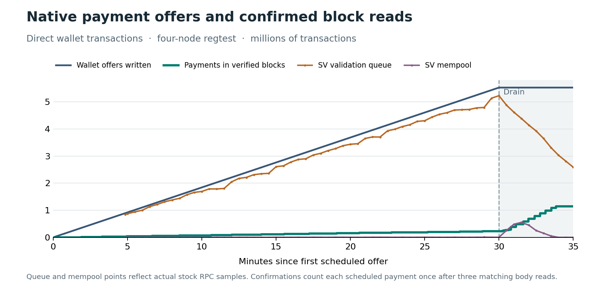

# Prospective 30-minute native transaction and Stratum workload

## Enrollment

One scheduled run uses the same independent disk-backed four-node regtest project, Linux release, isolated native routes and workstation as the [32-block paired burst](mixed-storage-trial.md). The measured workload begins after 65,536 funded ordinary P2PK outputs are witnessed. Each output supplies a chain of transfers among eight disposable transaction signers. Parent outputs recur about every 21 seconds at the registered rate. The existing shared cohort lock covers measurement. The source uses only the isolated stock SV Bitcoin P2P listener. Scary Node receives ordinary transactions from its real native peers. The node's operator submission endpoints receive zero transactions.

The source schedules **5,529,600 distinct signed payments over 1,800 seconds** in 10,800 batches of 512, evenly spaced at six per second. Four normal wallet peer connections share batches. Preparation and signing take place outside the interval. Elapsed measurement starts at the first scheduled offer, even if delivery is delayed. A separate fixed schedule provides 300 proof-of-work opportunities at six-second intervals. In each group of four, three opportunities use a real Scary Node Stratum V1 session and the fourth uses the full SV miner. The 225 entrant and 75 reference opportunities are reported separately with readiness, rejected work, missed slots, accepted hashes, settlement and transaction counts. Neither scheduling loop waits for the other. Miner cadence is accelerated regtest time.

The primary targets are all 5,529,600 distinct payments included and **at least 3,000 signed spends/s from the first scheduled offer through the last required independent body readback and two successor confirmations**. Each full node must return the identical wire digest for every selected workload block. The entrant must have continuous body coverage and report its own witnessed checks; sampled mining readiness and receiver availability are separate observations. Report active adoption times, scheduled versus actual sends, source-side reject messages, outstanding payments, five-minute cohorts, each miner’s share, and any loss of readiness. A blocked work slot counts. There is one primary attempt; preserve partial measurements and report any lower rate.

After the 1,800-second offer window, continue the same six-second miner rotation if payments remain. Beginning 18 seconds into drain, the wallet may rebroadcast still-unconfirmed original bytes through the same native SV ingress, at or below the registered offer rate. Report retransmissions separately and count every payment at most once. After all payments appear, two reference successors settle the final payment block. The drain limit is 300 seconds. Report incomplete inclusion at that limit.

A one-second sampler records independent SV/Teranode heights and hashes, the entrant’s selected parent, pending count, readiness and peer transaction acceptance counters. Container memory/CPU and free disk samples run alongside; Aerospike namespace and disk usage are recorded periodically. The receipt identifies the exact binaries, source corpus commitments, each block header and body digest, script checks, and distinct signed payment count. Full wires remain available in the local run directory. The prior SQLite and Aerospike observations used a 34.6-second or 501.9-second block-input burst and remain separate.

Reserve at least 20 GiB on the workstation data volume and at least 12 GiB on the Docker backing filesystem throughout. A terminal resource stop is recorded as an incomplete attempt. At registration the two 9 GiB databases each reported 861,345 records and 631,733,024 used bytes after the paired trial.

## Reproduction

Keep the isolated Aerospike project at its paired workload's final active tip and retain that run's input corpus. Build the pinned Python test framework and Linux ARM64 node image from the [qualification runbook](chronicle-qualification.md). The wallet gateway publishes only a loopback port to the stock SV peer. The funding setup splits the 16,384 final outputs into 65,536 evidenced outputs. The same Scary Node participates through its existing native links and Stratum listener.

```sh
docker compose -p scary-node-throughput -f regtest/compose.yaml -f regtest/mixed.compose.yaml \
  -f regtest/mixed-native.compose.yaml -f regtest/mixed-aerospike.compose.yaml \
  -f regtest/sustained-wallet.compose.yaml up -d --no-build --pull never wallet-ingress
.native/py/bin/python qualification/sustained_corpus.py .native/paired-corpus .native/sustained-signed
.native/py/bin/python qualification/sustained_native.py .native/sustained-signed .native/sustained-run
```

Run the driver with a fresh output directory. It preserves the append-only source, opportunity, block, receiver and resource logs as well as the compressed summary. `frames.bin` contains complete regtest transaction messages in scheduled order, and `ids.bin` holds their 32-byte internal transaction IDs. Each active body is retained in `blocks/<hash>.block`. Counts of locally emitted wallet messages, native node intake and independently confirmed payments have distinct denominators.


Replay the compact receipt to check the fixed offer and miner schedules, active header chain and work, branch payment accounting, readback digests, timestamps and observed resource floors. The second command also reads all 5,529,600 native envelopes and independently recomputes each archived block’s Merkle root, source membership and five-minute cohort. A completed audit of a partial run returns an explicit failed adoption target. A corrupt or inconsistent receipt terminates verification with an error.

```sh
python3 qualification/verify_sustained_native.py .native/sustained-run/receipt.json.gz
python3 qualification/verify_sustained_native.py .native/sustained-run/receipt.json.gz \
  --corpus .native/sustained-signed --blocks .native/sustained-run/blocks
```

The replay checks transaction identities and commitments. Signature evidence comes from the live nodes’ validation observations. CPU and memory figures use cgroup counters from the seven services. The host and Docker reserve checks use the filesystems on which the run and node data reside.

## Verify the entire wallet source

Funding and receipt files can be packaged independently of the live node stores. The packaging command checks 483 linked historical regtest bodies, the 65,536 outputs in the height-484 funding block, the original stock receipt, the native message checksum and the ordered ID of every payment. It writes only the named workload files and the project license into the two archives. A separate signature audit follows each funded output through its ordered transfers. It uses the pinned SV Node functional framework’s signature-hash calculation and validates the signature with the public key from the preceding output. It checks recipients, amounts and fees without assigning hypothetical block heights to unconfirmed payments.

```sh
python3 qualification/sustained_dataset.py pack .native/paired-corpus .native/sustained-signed .native/offer-assets
python3 qualification/sustained_dataset.py unpack .native/offer-assets .native/replay --receipt .native/offer-assets/source-assets.json
.native/py/bin/python qualification/verify_payment_signatures.py .native/replay/sustained-signed .native/source-signatures.json
```

A new funding run creates fresh ECDSA signatures. Reusing the exact archived funding and transfer wires makes the transaction IDs comparable across the two registered relay configurations.

## Direct-wallet result on November 21, 2026

All four nodes selected the same block at height 618. **1,143,159 of 5,529,600 distinct signed payments met the independent body-read requirement in 2,100.007 seconds, or 544.36/s.** The registered 3,000/s target and full inclusion both failed. All 134 selected bodies from h485 through h618 matched byte-for-byte at SV Node and both Teranodes, covering 228,078,164 bytes. Scary Node recorded 1,143,159 successful input-script checks. The measured branch contained zero foreign payments and zero duplicate confirmations. Of the original population, 4,386,441 were outside the selected bodies at closure. [Compact receipt](evidence/chronicle-sustained-direct.json.gz)

| Measurement | Observed |
|---|---:|
| Scheduled wallet offers | 10,800 batches, 5,529,600 distinct signed payments |
| Original complete socket writes | 10,800 batches across four connections |
| Reported wallet disconnects / explicit peer rejects | 0 / 0 |
| Batch-start lateness, median / 95th percentile | 1.98 / 6.48 ms |
| Independent payments read by offer end at 1,800 s | 228,197 |
| Additional distinct confirmations read during drain | 914,962 |
| Reoffered during drain | 839,959 already-scheduled payments across 1,862 batches |
| Largest independently verified block | 100,248 ordinary payments, maximum observed wire size 19,998,174 bytes |
| Last included payment block / final selected height | 615 / 618 |
| Lowest sampled free space, workstation / Docker | 59.34 / 69.24 GiB |

The included subset gained three successors. The completion condition required successors after **every** registered payment had appeared, so the driver never entered its settlement phase. The last scheduled status sample and durable frozen records agree on `58d75823b137b205d44ce8bfd91f852d6cea8a14c7e292e94e766358135ed9bf` at height 618. The source offered payments in dependency order across 65,536 chains. The first five-minute source cohort contributed 921,060 confirmed payments. The final four source cohorts contributed none by the deadline.

| Five-minute period | Offered | Distinct members of this source cohort confirmed by closure | Cumulative independent reads by end of this period |
|---|---:|---:|---:|
| 0–5 min | 921,600 | 921,060 | 35,841 |
| 5–10 min | 921,600 | 222,099 | 74,585 |
| 10–15 min | 921,600 | 0 | 116,578 |
| 15–20 min | 921,600 | 0 | 160,078 |
| 20–25 min | 921,600 | 0 | 191,030 |
| 25–30 min | 921,600 | 0 | 228,197 |
| 30–35 min drain | 0 new | — | 1,143,159 |

| Primary six-second opportunities | Scary Node | Full SV miner |
|---|---:|---:|
| Scheduled | 225 | 75 |
| Solved | 74 | 75 |
| Unready | 67 | 0 |
| Missed while previous work was outstanding | 83 | 0 |
| Worker timeout | 1 | 0 |
| Returned solution selected on the final audited branch | 68 | 54 |
| Returned solution absent from that branch | 6 | 21 |
| Payments in final-branch blocks from these primary slots | 64,475 | 224,214 |

Every primary opportunity is counted. During drain there were 12 more full SV solutions, 27 unready Scary slots and 10 missed Scary slots. Final-branch totals across both phases were 64,475 payments in Scary solutions and 1,078,684 in SV solutions. A successful primary SV call took a median 9.70 seconds and a maximum 19.01 seconds. Successful Scary Stratum calls took a median 0.36 seconds and a maximum 0.83 seconds. Only one mining operation could occupy the shared worker at a time. Long SV calls therefore affected subsequent scheduled Scary opportunities. This workload did not match both miners' hashpower or provide a stale-rate control.

The sampler obtained 2,065 status readings from each of the four nodes. Scary had an unready observation window in 14 readings. It lacked an issuable job in 1,264 readings, including 1,139 with no eligible pending payment, 111 awaiting independent observation after its own solution, and the 14 unready-window readings. All initial funding rails were created on h484. Scary's candidate rule requires a successor for a newly witnessed confirmed output, so immediately spending those rails could not supply a first job while h484 remained the tip. The receipt also records admissions from both the stock SV and Teranode subtree routes. [Candidate admission rule](https://github.com/p2ppsr/scary-node/blob/af9b605ad8da96d041a540111d46a7c0105209f7/src/mining.rs#L790-L798)

### Where the backlog formed



The plot uses actual send completion times, independent body-read completion times and stock RPC sample timestamps. [Figure reproduction](../qualification/plot_sustained.py)

A supplementary read-only SV sampler began 290.43 seconds after the first offer. It took 62 readings through the end of drain. At t=1,800s SV reported 5,228,885 transactions processing or awaiting validation and 3,242 in its mempool. At t=1,830s those values were 4,884,498 and 255,770. At t=1,890s the sampled mempool reached 553,741. The sampled orphan-pool count was zero throughout. Immediately before the original containers were paused, the stock reference still reported 2,589,147 transactions in or awaiting validation and zero in its mempool. A queue entry is an item of work. It does not establish unique inclusion. [Read-only stock gauges](evidence/chronicle-sustained-direct-stock.jsonl.gz) · [SV stock gauge definition](https://github.com/bitcoin-sv/bitcoin-sv/blob/6504a3aff65ba97c0f6c80962b033e35ecbfed4b/src/rpc/blockchain.cpp#L3649-L3683)

Two stock settings help interpret this result. The enrolled 20 MB SV block-size limit also restricted a stock transaction inventory retrieval to 700 entries. SV’s regtest defaults enabled a full mempool consistency check for each accepted transaction, an operation SV documents as quadratic as the pool grows. The four direct-wallet sessions closed after the offer interval. The stock code uses the source peer handle during normal post-validation diagnostics and relay. The queue then fell and several full-node blocks approached the measured 20 MB limit. The time series identifies the stock-side validation backlog and a change in processing during drain. It does not isolate how much throughput each setting, wallet lifetime or miner schedule contributed. The 15,140/s result from the earlier preassembled-block burst had a different entry path and denominator. [Stock regtest defaults](https://github.com/bitcoin-sv/bitcoin-sv/blob/6504a3aff65ba97c0f6c80962b033e35ecbfed4b/src/init.cpp#L2339-L2351) · [Stock mempool cost](https://github.com/bitcoin-sv/bitcoin-sv/blob/6504a3aff65ba97c0f6c80962b033e35ecbfed4b/src/txmempool.h#L425-L429) · [Peer-aware post-validation processing](https://github.com/bitcoin-sv/bitcoin-sv/blob/6504a3aff65ba97c0f6c80962b033e35ecbfed4b/src/validation.cpp#L2096-L2116) · [Paired block-input burst](mixed-storage-trial.md)

### Closed evidence and reproduction

The final handoff paused all eight containers in the enrolled project and retained their volumes. An optional supplemental query used the default 194xx loopback ports for TN1, TN2 and Scary and returned the paired fixture's h483. Those three rows and the associated suffix field in the original handoff are superseded. Its stock SV query and project pause were correctly addressed. The measured workload used the enrolled 214xx ports. All four final scheduled samples reported h618. A subsequent read-only inspection independently recovered h618 directly from each paused Teranode's SQLite main-chain row and the Scary checkpoint's last header, including verification of the checkpoint's internal SHA-256 checksum. The original handoff remains available beside the correction. [Original handoff](evidence/chronicle-sustained-direct-handoff.json) · [Frozen-store correction](evidence/chronicle-sustained-direct-frozen.json)

```sh
python3 qualification/verify_sustained_native.py docs/evidence/chronicle-sustained-direct.json.gz
python3 qualification/quiesce_sustained.py docs/evidence/chronicle-sustained-direct.json.gz \
  --stock-log docs/evidence/chronicle-sustained-direct-stock.jsonl.gz \
  --handoff docs/evidence/chronicle-sustained-direct-handoff.json \
  --frozen docs/evidence/chronicle-sustained-direct-frozen.json
python3 qualification/verify_sustained_native.py docs/evidence/chronicle-sustained-direct.json.gz \
  --corpus .native/sustained-signed --blocks .native/sustained-run/blocks
```

The full offline replay rehashed all 5,529,600 signed source envelopes, recomputed every selected transaction Merkle commitment across 134 bodies, and recovered the same 1,143,159 distinct signed members. The source dataset and selected body archives can be unpacked into the `--corpus` and `--blocks` directories above. [Outcome asset digests](evidence/chronicle-sustained-direct-assets.json) · [Public workload release](https://github.com/p2ppsr/scary-node/releases/tag/native-workload-regtest-v1)

On the original frozen Docker project, `uv run --with msgpack==1.1.2 python qualification/sustained_frozen.py .native/sustained-run/receipt.json.gz .native/sustained-run/quiesced.json` reads copies of the project-specific volumes. The dedicated [production-settings replication](sustained-native-replication.md) uses the same signed population, a distinct stock configuration and inventory/request-based wallet delivery. Both studies use one physical workstation and accelerated regtest work.
