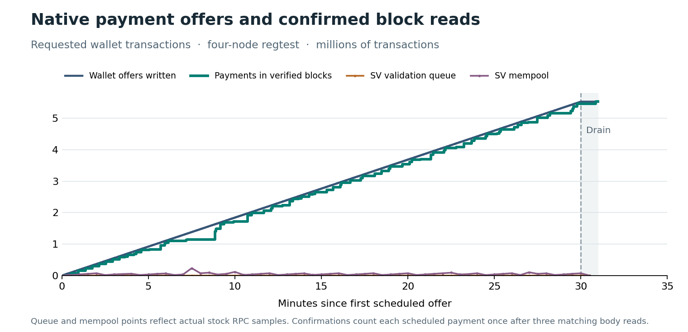

# Mining with a witnessed UTXO set under continuous wallet traffic

## Reordered payments on the original release

The four-node regtest confirmed **5,529,600 distinct signed payments**. Scary Node originated **29 selected, transaction-bearing blocks during the 300 primary opportunities** and one during drain. Each of the six five-minute primary windows contained at least two. The entrant recorded 5,529,600 script checks. All four nodes selected two successors after the last payment. Across both producers, settlement took **1,859.220269 seconds**, or **2,974.15 payments/s**. The registered regular-origination criterion passed even using only worker-returned hashes. The joint criterion required at least 3,000/s. [Primary receipt](evidence/chronicle-sustained-reordered.json.gz) · [Registration and source order](witnessed-miner-registration.md)

The entrant joined empty before the funding was mined and observed the common split at height 484. At first offer that block had zero successors. After eight generations, the four wallets changed the announcement order of successive spends of the 65,536 funding outputs. The same signed payments in the original-order inventory control yielded no selected Scary block. Here the entrant's 29 primary selected blocks carried **235,809 payments** and its drain block carried 128. Of the primary total, **235,734** were in 26 blocks whose hash the worker received. Three more selected primary blocks were first identified from independent full body reads and the entrant’s own solved ledger. SV Node's 63 selected primary blocks contained 5,227,231 payments. [Original-order control](sustained-native-replication.md) · [Endorsed funding and original wallet order](endorsed-workload-interruption.md) · [Original entrant journal](evidence/chronicle-sustained-reordered-ledger.json)

| Primary slots | Selected Scary blocks with worker hash | Payments in those blocks | All selected Scary blocks | Payments in all selected Scary blocks |
|---|---:|---:|---:|---:|
| 0–49 | 5 | 40,816 | 5 | 40,816 |
| 50–99 | 9 | 88,879 | 9 | 88,879 |
| 100–149 | 5 | 47,646 | 6 | 47,710 |
| 150–199 | 2 | 1,535 | 2 | 1,535 |
| 200–249 | 3 | 46,106 | 4 | 46,107 |
| 250–299 | 2 | 10,752 | 3 | 10,762 |

All 300 primary opportunities have a recorded outcome. Of Scary's 225 opportunities, 51 returned solutions, 159 found work unavailable, seven were missed, six returned errors and two submissions were rejected. Of the 159 unready slots, 95 had no eligible pending transaction, 49 awaited independent observation after an earlier solution on the parent, and 15 had an unready observation window. SV Node returned solutions in 72 of 75 opportunities and missed three. The final audited branch contained 26 of the returned Scary solutions and 63 of the returned stock solutions. The 225/75 schedule and unequal production paths cannot estimate an equal-hashpower stale-rate difference. [Matched propagation study](propagation-control.md)

### Four selected blocks outlived the worker reply

All four headers below appear in the original entrant’s checksum-verified solved journal. The hash, parent and height match the selected complete block separately read from SV Node and two Teranodes. Each coinbase contains the entrant’s mining-domain commitment and pays its configured script. For each journal entry, its parent matched exactly one ready Stratum slot whose worker timed out. The historical worker retained no submitted header for those slots, so the association to the slot uses that unique parent match. The block’s origin is independently evidenced by the original local entry and the three full stock reads. [Original solved journal](evidence/chronicle-sustained-reordered-ledger.json) · [Canonical headers and worker replies](evidence/chronicle-sustained-reordered.json.gz)

| Height | Worker phase and slot | Persisted job | Payments | Fees in satoshis |
|---:|---|---|---:|---:|
| 524 | Offer 124 | `5f49c` | 64 | 12,800 |
| 550 | Offer 204 | `cd506` | 1 | 200 |
| 568 | Offer 269 | `1045ab` | 10 | 2,000 |
| 577 | Drain 300 | `11db76` | 128 | 25,600 |

Both original Teranode service logs independently name the entrant’s public Ed25519 libp2p peer. Hashing its public-key protobuf twice with SHA-256 reproduces the mining-domain digest in the entrant’s local fencing directory and in all 30 selected Scary coinbases. The native peer appeared on 151 log lines at the first Teranode and 157 at the second. The identity corroborates the header and journal matches above. [Independent peer identity and log commitments](evidence/chronicle-sustained-reordered-identity.json)

The frozen journal retained all 56 solutions generated in the session. It recorded 30 settled and 26 stale at depth. The three other error slots, 104, 144 and 272, had no locally journaled child on their sampled parent. Each of the four selected timeout entries records a stock body send, a later active-header request, two tip reporters and eventual settlement. The last locally retained full solution body was a different height-578 sibling. The original R timing cannot distinguish whether a Stratum reply was delayed or lost in transit. A separate controlled regtest deliberately dropped the worker reply and verified selection of the exact pre-recorded header. [Lost-reply experiment](evidence/chronicle-stratum-lost-reply.json)

### Which miner collected the fees

The signed source and three stock body reads place every payment in one selected block. Replaying the exact previous output and value gives **200 satoshis per payment**. Scary collected **47,187,400 satoshis** above subsidy in its 30 selected coinbases. SV Node collected **1,058,732,600 satoshis** in the other 66. Each coinbase claimed its full available reward. Among the entrant's 235,937 selected payments, 57,120 spent an earlier transaction in the same block and 178,817 spent a confirmed output created two to six blocks before inclusion. Zero spent an output from the immediately preceding block. SV Node’s 5,293,663 payments included 2,895,627 same-block spends and 1,093,980 immediate-parent spends. The older confirmed inputs gave Scary eligible roots for packages that also paid it for same-block descendants. In the endorsed original-order experiment, the last 57 measured blocks had zero roots older than the immediately preceding tip. These sessions changed both the initial funding depth and subsequent offer order. The earlier cold inventory control used the same executable and zero-successor starting boundary as this reordered run. Each condition had one measured session. [Coinbases, fees and input ages by block](evidence/chronicle-sustained-reordered-fees.json)

### Where the final 59.220269 seconds went

The last primary inventory write completed at **1,799.875029 s** against a scheduled **1,799.833333 s**. At **1,800.078751 s**, the wallets had already served every distinct signed payment. At the nominal 1,800-second offer boundary, complete body audits covered 5,457,408 payments. SV Node reported 72,192 mempool transactions and zero validation-queue items at 1,800.198 s. In a separate sample at 1,830.150 s it reported an empty mempool, 4,527 queued items and 62,056 orphan transactions. These are point-in-time stock gauges. The observation does not assign an individual transaction's delay to a queue. [Original stock gauges and wallet counters](evidence/chronicle-sustained-reordered.json.gz)

During drain, the wallets sent 83 further inventory advertisements containing 42,496 entries. The first write finished at **1,818.461294 s** and the last at **1,850.607168 s**. The terminal wallet totals were 5,920,110 requests and 5,917,038 transaction deliveries, including repeats, with zero unknown requests. The final paying block at height 578 contained 66,432 payments in 13,253,054 bytes. The table gives elapsed seconds for each first sampled tip and the completed body audit. Each audit compared the full bodies from SV Node and both Teranodes and checked the entrant's observation. The receipt records one completion time for that group and a separate matching wire digest for each stock reader. [Settlement timestamps, body commitments and wallet counters](evidence/chronicle-sustained-reordered-settlement.json)

| Height | Payments | SV Node tip | Teranode A tip | Teranode B tip | Scary tip | Body audit complete |
|---:|---:|---:|---:|---:|---:|---:|
| 578 | 66,432 | 1,831.812 | 1,831.854 | 1,831.878 | 1,846.680 | 1,850.610 |
| 579 | 0 | 1,850.601 | 1,850.607 | 1,850.611 | 1,855.889 | 1,857.701 |
| 580 | 0 | 1,856.446 | 1,856.450 | 1,856.454 | 1,857.579 | 1,859.155 |

At 3,000/s the fixed cohort allows **1,843.200 s** from first scheduled offer. The final paying-block audit completed 7.409521 s after that point. Another 8.610748 s elapsed through the two successors and closure, bringing the complete denominator to **1,859.220269 s**, 16.020269 s over the target. The handoff queries independently found SV Node, both Teranodes and Scary Node at height 580 on hash `5754c4a0292ba4c9ea34bb59f721b7b28e39d5806300681823f305890e8783b4`. All eight original services were then paused. Two subsequent checks against those same services found SV Node and Scary Node each had an empty pool. Both Teranodes served an empty next-block candidate in both checks. [Terminal handoff](evidence/chronicle-sustained-reordered-handoff.json) · [Two original pool and candidate readbacks](evidence/chronicle-sustained-reordered-terminal.json)

### Operating conditions

The seven resource-sampled services shared a Docker VM with 16 vCPUs and 102,380,195,840 bytes of RAM on a 16-core Apple M3 Max host with 128 GiB of RAM. The registered entrant was the Linux ARM64 executable from source `af9b605`. Scary Node peaked at 2,076,884,992 sampled container bytes. The 96 selected bodies totaled 1,103,144,251 bytes. The largest was 50,528,298 bytes. The lowest sampled host and Docker free capacities were 26.04 GiB and 19.11 GiB. No resource stop or audit failure occurred. This is one mixed-node session on one host. The measured system and entrant rates have different numerators. [Runtime platform](evidence/chronicle-sustained-reordered-platform.json) · [Resource observations](evidence/chronicle-sustained-reordered.json.gz)

### Reproduce the accounting

Use the qualification Python environment. The first command verifies the registered clock, branch and signed membership commitments recorded in the primary receipt. The next commands independently reconstruct the window and settlement tables and check all four handoff receivers. The registration contains the steps to replay the identical signed wallet workload on fresh Docker stores. [Funding, release and independent-run instructions](witnessed-miner-registration.md)

~~~sh
receipt=docs/evidence/chronicle-sustained-reordered.json.gz
.native/py/bin/python qualification/verify_sustained_native.py "$receipt"
.native/py/bin/python qualification/workload_windows.py "$receipt"
.native/py/bin/python qualification/workload_settlement.py "$receipt"
.native/py/bin/python qualification/workload_terminal_pools.py verify "$receipt" \
  docs/evidence/chronicle-sustained-reordered-terminal.json
.native/py/bin/python qualification/workload_solved_ledger.py verify "$receipt" \
  docs/evidence/chronicle-sustained-reordered-ledger.json
.native/py/bin/python qualification/workload_block_fees.py owners "$receipt" \
  docs/evidence/chronicle-sustained-reordered-fees.json \
  docs/evidence/chronicle-sustained-reordered-ledger.json
.native/py/bin/python qualification/quiesce_sustained.py "$receipt" \
  --handoff docs/evidence/chronicle-sustained-reordered-handoff.json
~~~

The 8,277,033-byte reordered archive reconstructs all 1,103,144,251 observed block bytes from the common signed corpus. Its SHA-256 is `e51b3237bca4d521da139ea4288470a1bbf4fc37aa7cefd638120490f3bc4c27`. The wallet bitmaps each contain one byte per offered ID after decompression. [Reordered archive and wallet bitmaps](https://github.com/p2ppsr/scary-node/releases/tag/native-workload-witnessed-arms-v1) · [Common signed corpus](https://github.com/p2ppsr/scary-node/releases/tag/native-workload-regtest-v1)

~~~sh
gh release download native-workload-regtest-v1 --repo p2ppsr/scary-node --dir offer-assets \
  --pattern paired-corpus.tar.gz --pattern sustained-signed.tar.gz
.native/py/bin/python qualification/sustained_dataset.py unpack offer-assets workload \
  --receipt docs/evidence/chronicle-sustained-source-assets.json
gh release download native-workload-witnessed-arms-v1 --repo p2ppsr/scary-node --dir reordered-assets \
  --pattern 'reordered*'
SIGNED_PAYMENTS=workload/sustained-signed
RECONSTRUCTED_BLOCKS=reordered-assets/blocks
.native/py/bin/python qualification/sustained_block_archive.py unpack "$receipt" "$SIGNED_PAYMENTS" \
  reordered-assets/reordered.zip "$RECONSTRUCTED_BLOCKS"
gzip -dc reordered-assets/reordered-requested.bits.gz > reordered-assets/requested.bits
gzip -dc reordered-assets/reordered-served.bits.gz > reordered-assets/served.bits
.native/py/bin/python qualification/verify_sustained_native.py "$receipt" \
  --corpus "$SIGNED_PAYMENTS" --blocks "$RECONSTRUCTED_BLOCKS" --parent-ages
~~~

After a local regtest run, use the data directory from the paused original entrant or an isolated byte-for-byte restoration. The extractor reads the checksum-protected `witness.state` and its sibling `mining-domain-<digest>` binding. The shared identity value lives in the filename and is independently committed in each originated coinbase. The command exports only solution fields and anonymized peer event times. Keep the original node’s private keys and full checkpoint under operator custody.

~~~sh
.native/py/bin/pip install msgpack==1.1.2
.native/py/bin/python qualification/workload_solved_ledger.py extract \
  "$ORIGINAL_DATA/regtest/witness.state" > local-solved-ledger.json
.native/py/bin/python qualification/workload_peer_identity.py local-solved-ledger.json \
  "$ORIGINAL_TN1_TIMESTAMPED_LOG" "$ORIGINAL_TN2_TIMESTAMPED_LOG"
.native/py/bin/python qualification/workload_block_fees.py wires "$receipt" \
  "$SIGNED_PAYMENTS" "$RECONSTRUCTED_BLOCKS" > local-selected-fees.json
~~~
